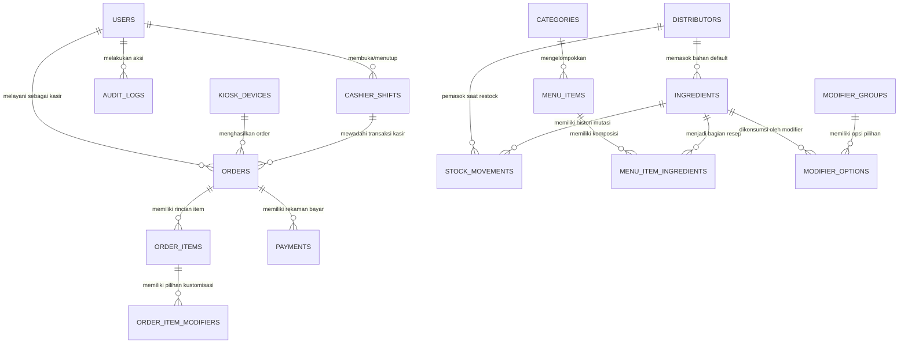

# Panduan Komprehensif & Catatan Arsitektur Sistem Our Coffee (Native Blade)

> **Dokumen Studi & Referensi Teknis (Comprehensive Codebase Study Guide)**  
> Disusun untuk keperluan penguasaan arsitektur **100% Native Laravel Blade + Alpine.js 3 + Tailwind CSS v4**, persiapan sidang/presentasi tugas akhir/skripsi, serta panduan pengembangan (_extensibility guide_) aplikasi **Our Coffee**.

---

## DAFTAR ISI

1. [Ringkasan Eksekutif & Domain Masalah](#1-ringkasan-eksekutif--domain-masalah)
2. [Arsitektur Perangkat Lunak & Design Pattern](#2-arsitektur-perangkat-lunak--design-pattern)
3. [Analisis Mendalam Framework & Teknologi: Apa, Bagaimana, & Mengapa](#3-analisis-mendalam-framework--teknologi-apa-bagaimana--mengapa)
4. [Pohon Direktori Lengkap & Penjelasan File](#4-pohon-direktori-lengkap--penjelasan-file)
5. [Skema Basis Data & Relasi Eloquent (Data Layer)](#5-skema-basis-data--relasi-eloquent-data-layer)
6. [Bedah Logika Bisnis: 8 Service Layer Utama](#6-bedah-logika-bisnis-8-service-layer-utama)
7. [Alur Transaksi & State Machine (Life Cycle of an Order)](#7-alur-transaksi--state-machine-life-cycle-of-an-order)
8. [Frontend Architecture, Alpine.js State & Visibility-Aware Polling](#8-frontend-architecture-alpinejs-state--visibility-aware-polling)
9. [Panduan Menjawab Pertanyaan Dosen (Defense Q&A Guide)](#9-panduan-menjawab-pertanyaan-dosen-defense-qa-guide)
10. [Panduan Menambah Fitur Baru (How-To Tutorial)](#10-panduan-menambah-fitur-baru-how-to-tutorial)
11. [Kredensial Default & Perintah Esensial](#11-kredensial-default--perintah-esensial)

---

## 1. RINGKASAN EKSEKUTIF & DOMAIN MASALAH

### 1.1 Apa Itu Our Coffee?

**Our Coffee** adalah sistem operasional coffee shop _omnichannel_ terintegrasi berbasis web responsif modern menggunakan **100% Native Laravel Blade**. Aplikasi ini menggabungkan seluruh titik interaksi (_touchpoints_) bisnis kafe ke dalam satu basis data dan satu alur logika yang sinkron secara _real-time_:

1. **Self-Service Kiosk (`/kiosk`)**: Layar sentuh mandiri bagi pelanggan untuk memilih tipe pesanan (_Dine-In_ / _Takeaway_), nama panggilan antrean, menu, modifier (rasa/susu/ukuran/catatan), serta membayar lewat **QRIS Instant** maupun **Bayar di Kasir**.
2. **Point of Sale / POS Kasir (`/pos`, `/pos/shift`)**: Antarmuka kasir untuk memproses pesanan langsung (_walk-in_), melunasi antrean pesanan dari Kiosk, manajemen buka/tutup shift + rekonsiliasi selisih kas, cetak struk termal (58mm / 80mm), diskon manual ber-PIN, dan pembatalan pesanan (_void_).
3. **Kitchen Display System / KDS (`/kds`)**: Layar dapur dan meja barista 3 kolom (_Antre_, _Sedang Dibuat_, _Siap Diambil_) lengkap dengan SLA timer detik `MM:SS`, tombol _undo_ 1 langkah, dan sinyal lonceng audio.
4. **Queue Display TV (`/display/queue`)**: Layar publik di atas konter pengambilan untuk menampilkan nomor antrean yang sedang disiapkan dan yang sudah siap diambil, lengkap dengan jam WIB real-time.
5. **Back-Office Admin (`/admin/*`)**: Dashboard analitik otomatis (KPI, tren omzet 7/30 hari, donat channel, heatmap 24 jam, Top 5 menu & margin, stok menipis), manajemen kategori, menu & resep _Bill of Materials_ (BOM), modifier, inventaris & mutasi stok, distributor, laporan + ekspor CSV, karyawan & PIN 6-digit, audit log berformat terstruktur (_immutable_), dan pengaturan kafe + pairing token Kiosk.

### 1.2 Masalah Riil yang Dipecahkan

- **Pencegahan Human Error & Antrean Panjang**: Memindahkan beban pemesanan dan kustomisasi varian ke mesin Kiosk pelanggan.
- **Transparansi Bahan Baku & HPP (BOM Costing)**: Setiap cangkir kopi yang terjual otomatis menghitung HPP (_Cost of Goods Sold_) berdasarkan takaran resep gram/ml/pcs (termasuk bahan pada modifier) dan memotong stok fisik secara atomik saat pembayaran lunas.
- **Pencegahan _Theft_ dan Kebocoran Kas**: Kasir tidak dapat memberi diskon manual atau membatalkan (_void_) pesanan yang sudah bayar tanpa verifikasi PIN 6-digit Supervisor/Admin. Seluruh aksi sensitif tercatat pada `audit_logs`.
- **Integritas Konkurensi**: Tidak terjadi penjualan melebihi kapasitas stok (_overselling_) ataupun nomor antrean kembar saat beberapa pelanggan checkout pada detik yang sama.

---

## 2. ARSITEKTUR PERANGKAT LUNAK & DESIGN PATTERN

```
+-----------------------------------------------------------------------------------+
|                                  CLIENT LAYER                                     |
|  [ Kiosk Screen ]   [ POS Kasir ]   [ KDS Barista ]   [ Queue TV ]   [ Admin CMS] |
|                 (Native Laravel Blade SSR + Alpine.js 3 + Tailwind CSS v4)        |
+-----------------------------------------------------------------------------------+
                                          |
       HTML SSR (Blade Views & Form POST/PUT/PATCH/DELETE) + AJAX JSON + CSRF Token
                                          |
+-----------------------------------------------------------------------------------+
|                                 ROUTING & MIDDLEWARE                              |
|  - Role Guard (EnsureUserHasRole: admin, kasir, barista)                          |
|  - Shift Guard (EnsureShiftIsOpen)                                                |
|  - Device Guard (EnsureKioskDevice via Device Token Cookie)                       |
|  - Shared View Middleware (HandleAppearance, ShareViewData)                       |
+-----------------------------------------------------------------------------------+
                                          |
+-----------------------------------------------------------------------------------+
|                             CONTROLLER LAYER (Thin)                               |
|  - Validasi HTTP Request & Form Input                                             |
|  - Delegasi eksekusi ke Service Layer                                             |
|  - Mengembalikan view(...) (Blade), Redirect, atau JsonResponse (Polling/API)     |
+-----------------------------------------------------------------------------------+
                                          |
+-----------------------------------------------------------------------------------+
|                              SERVICE LAYER (Domain Logic)                         |
|  OrderService | InventoryService | BomCostService | MenuAvailabilityService       |
|  QueueNumberGenerator | PinAuthorizationService | AuditLogService | QrisGateway   |
+-----------------------------------------------------------------------------------+
                                          |
+-----------------------------------------------------------------------------------+
|                            DATA & REPOSITORY LAYER                                |
|  - Eloquent ORM Models (17 Model: Relationships, Casts, Mutators, Scopes)         |
|  - Strict Lazy-Loading Prevention (Model::preventLazyLoading di non-production)   |
|  - Database Transactions (DB::transaction) & Pessimistic Locking (lockForUpdate)  |
|  - MySQL / MariaDB (InnoDB Storage Engine)                                        |
+-----------------------------------------------------------------------------------+
```

### 2.1 Pola-Pola Desain Utama yang Diterapkan

1. **Service Layer Pattern**: Logika bisnis tidak diletakkan di Controller atau Model, melainkan dipusatkan di folder `app/Services/`. Ini memastikan prinsip _Single Responsibility_ dan logika dapat dipakai ulang (_reusable_) oleh POS, Kiosk, Admin, Seeder, maupun Automated Test.
2. **Contract / Interface-Driven Architecture**: Digunakan pada `QrisGatewayInterface` yang diimplementasikan oleh `SimulatedQrisGateway`. Pola ini memudahkan integrasi payment gateway pihak ketiga (Midtrans, Xendit, atau DOKU) tanpa merombak `OrderService`.
3. **Pessimistic Locking (`lockForUpdate`)**: Menjamin integritas pemotongan stok bahan baku dan penomoran antrean di lingkungan multi-user konkuren.
4. **Deadlock Prevention (Ordered Lock Acquisition)**: Dalam `InventoryService::deductForOrder()`, ID bahan baku selalu diurutkan (`sort($ingredientIds)`) sebelum dikunci dengan `lockForUpdate()`, memutus kondisi _Circular Wait_ pada teori deadlock basis data.
5. **State Pattern & Explicit Transition Matrix**: Status pesanan (`OrderStatus`) dikontrol melalui matriks transisi yang ketat. KDS mendukung alur maju dan pembatalan 1 langkah (_undo_).
6. **Immutable Audit Logging**: Entri `audit_logs` merekam aktor, otorisator PIN, objek, alasan, metadata JSON, dan IP address. Tidak ada route edit ataupun hapus untuk log audit.
7. **Server-Driven HTML + JSON Data Island Pattern**: Controller merender halaman Blade murni (`view(...)`) dan menyisipkan state awal terstruktur via `<script type="application/json">` yang dibaca bersih oleh komponen `Alpine.data(...)` — bebas dari kompleksitas bundler SPA maupun risiko XSS dari JSON inline attribute.

---

## 3. ANALISIS MENDALAM FRAMEWORK & TEKNOLOGI: APA, BAGAIMANA, & MENGAPA

Bagian ini membahas teknologi yang digunakan pada arsitektur **Our Coffee** versi **100% Native Blade** dengan format: **Apa itu**, **Bagaimana implementasinya**, dan **Mengapa dipilih**.

---

### 3.1 PHP 8.3 & Laravel 13 (Backend Core & Enterprise Engine)

#### A. Apa Itu?

- **PHP 8.3**: Bahasa pemrograman server modern dengan dukungan _strict types_, performa tinggi (JIT + OPcache), _Readonly Properties_, `match` expression, dan _Constructor Property Promotion_.
- **Laravel 13 (`laravel/framework: ^13.17`)**: Framework web PHP berarsitektur MVC dengan ekosistem keamanan, validasi, migrasi, Eloquent ORM, dan Blade templating engine bawaan.

#### B. Bagaimana Digunakan dalam Our Coffee?

1. **Strict Types & Dependency Injection**: Seluruh berkas PHP di `app/` diawali `declare(strict_types=1);` dengan _Constructor Property Promotion_ di lapisan Service & Controller.
2. **Type-Safe Backed Enums**: 11 Backed Enums di `app/Enums/` (`OrderStatus`, `PaymentMethod`, `StockMovementType`, `UserRole`, `IngredientUnit`, `MenuBadge`, `ModifierSelectionType`, dll.) mencegah _magic strings_ yang rawan typo.
3. **Prevent Lazy Loading (N+1 Protection)**: Di `app/Providers/AppServiceProvider.php`, `Model::preventLazyLoading(! app()->isProduction())` diaktifkan agar setiap relasi wajib di-_eager load_ (`with(...)`).
4. **ShareViewData Middleware**: `app/Http/Middleware/ShareViewData.php` membagikan variabel global seperti `$activeShift` ke seluruh view Blade melalui `View::share()` tanpa melanggar aturan _lazy loading_ (`$user->activeShift()->first()`).

#### C. Perbandingan dengan Alternatif Backend:

| Framework / Bahasa       | Kelebihan                                                    | Kelemahan Dibanding Laravel 13 di Our Coffee                                                                                                                          |
| :----------------------- | :----------------------------------------------------------- | :-------------------------------------------------------------------------------------------------------------------------------------------------------------------- |
| **Express.js / Node.js** | Ringan, I/O non-blocking, bahasa JavaScript penuh.           | Tidak memiliki struktur standar bawaan (harus merakit ORM, auth, migrasi, validasi secara manual); transaksi ACID & locking relasional jauh lebih rentan boilerplate. |
| **Django (Python)**      | Built-in admin panel cepat dan ORM kuat.                     | Template engine Django kurang ergonomis dibanding sistem **Anonymous Blade Component + Alpine.js** serta ekosistem POS/auth siap pakai seperti Fortify + Pest.        |
| **Spring Boot (Java)**   | Kinerja sangat tinggi untuk skala korporasi perbankan besar. | Overhead konfigurasi masif (_over-engineering_), konsumsi RAM besar bahkan saat idle, dan siklus iterasi fitur kafe jauh lebih lambat.                                |

---

### 3.2 Native Laravel Blade & Anonymous Components (Server-Side Rendering Engine)

#### A. Apa Itu?

**Blade** adalah engine templating resmi Laravel yang mengompilasi berkas `.blade.php` menjadi kode PHP murni yang sangat cepat dan disimpan di `storage/framework/views/` (zero overhead parsing di runtime).

#### B. Bagaimana Digunakan dalam Our Coffee?

1. **Return Native `view()` di Seluruh Controller**:
    ```php
    // app/Http/Controllers/Pos/PosController.php
    return view('pos.index', [
        'categories' => $catalog,
        'pendingKioskOrders' => $queues['pendingKioskOrders'],
        'recentOrders' => $queues['recentOrders'],
        'cafeSettings' => [...],
    ]);
    ```
2. **Anonymous Blade Components (`resources/views/components/`)**:
   Seluruh layout dan elemen UI dipecah menjadi komponen bersih dengan sintaks tag `<x-...>` + `@props(...)`:
    - `<x-layouts.base>`: Kerangka HTML utama, meta CSRF, script tema dark/light anti-FOUC, `@vite(['resources/css/app.css', 'resources/js/app.js'])`, dan `<x-toaster />`.
    - `<x-layouts.rail>`: Sidebar navigasi berbasis role (_Admin/Kasir/Barista_), kartu status `Shift Aktif`, profil user, dan tombol logout.
    - `<x-layouts.auth>` & `<x-layouts.settings>`: Pembungkus halaman autentikasi & pengaturan akun.
    - `<x-icon>`, `<x-toaster>`, `<x-password-input>`, `<x-stock-level-bar>`.
3. **JSON Data Islands (`<script type="application/json">`)**:
   Untuk halaman kaya interaktivitas (Kiosk, POS, KDS, Display, Dashboard Admin, Menu BOM), data PHP diserialisasi dengan aman memakai `{!! json_encode([...], JSON_HEX_TAG) !!}` di dalam `<script type="application/json">`, lalu diparsing di `Alpine.data` via `window.ocReadJsonScript(...)`.
4. **Proteksi Form Boolean Checkbox**:
   Setiap checkbox HTML pada form admin (seperti `is_active`, `is_available`, `is_required`, `is_default`) dipasangkan dengan `<input type="hidden" name="..." value="0">` agar nilai `false` tetap terkirim ke controller saat tidak dicentang.

#### C. Mengapa Memilih 100% Native Blade Dibanding Inertia + React/Vue?

1. **Satu Bahasa & Satu Pipeline Sederhana**: Tidak perlu membangun/merawat kode frontend TypeScript terpisah, tidak ada sinkronisasi tipe props manual, dan tidak ada build compiler framework SPA (React/Vue).
2. **Zero Runtime Abstraction Bug**: Tidak ada konflik virtual DOM, ketergantungan adapter `@inertiajs/*`, atau kendala render komponen ikon/ekosistem JS.
3. **Keamanan & Performa Bawaan**: Seluruh otentikasi menggunakan session HTTP-Only cookie + `@csrf` native Laravel, serta halaman langsung ter-render dari server (_First Contentful Paint_ sangat cepat bahkan di perangkat tablet spesifikasi rendah).

---

### 3.3 Alpine.js 3 (Lightweight Reactive Frontend Layer)

#### A. Apa Itu?

**Alpine.js 3 (`alpinejs: ^3.14.8`)** adalah framework JavaScript reaktif yang ringan dan deklaratif — sering dijuluki _"jQuery untuk era modern"_ atau _"Tailwind-nya JavaScript"_. Seluruh logika interaktif sisi klien berada dalam satu berkas bersih: `resources/js/app.js`.

#### B. Bagaimana Digunakan dalam Our Coffee?

1. **Global Reactive Stores**:
    - `Alpine.store('theme')`: Sinkronisasi mode tema (`light`, `dark`, `system`) ke `localStorage`, cookie `appearance`, dan class `.dark` pada `<html>`.
    - `Alpine.store('toasts')`: Menampilkan notifikasi toast dari flash session Laravel maupun respon aksi AJAX secara real-time.
2. **Komponen Interaktif `Alpine.data(...)`**:
    - `kioskApp`: Mengelola state 4 layar Kiosk, pemilihan tipe order, validasi modifier, keranjang belanja, modal QRIS + timer kedaluwarsa, _idle timeout watchdog_, dan _5-tap hidden exit modal_.
    - `posApp`: Mengelola keranjang Walk-In, tab Antrean Bayar Kiosk, Riwayat Shift, modal diskon ber-PIN, papan NumPad pembayaran tunai, void modal, dan pratinjau/cetak struk termal 58mm/80mm.
    - `posShiftApp`: Kalkulator selisih kas aktual vs sistem secara _live_ saat tutup shift.
    - `kdsApp` & `queueDisplayApp`: Papan tiket dapur real-time, timer stopwatch WIB per tiket, dan pemutar bunyi lonceng Web Audio API (`ocPlayChime`).
    - `adminDashboardApp`: Switcher 7/30 hari, grafik bar tren omzet, donat SVG channel, heatmap jam sibuk, dan auto-refresh KPI.
    - Modal CRUD Backoffice (`adminCategoriesApp`, `adminMenusApp`, `adminModifiersApp`, `adminInventoryApp`, `adminDistributorsApp`, `adminStaffApp`, `adminSettingsApp`).
3. **Helper Komunikasi Aman (`ocJsonRequest`)**:
   Membungkus `fetch()` dengan header `X-CSRF-TOKEN`, `Accept: application/json`, dan parsing pesan validasi Laravel (`422` / `409`) secara konsisten.

#### C. Mengapa Memilih Alpine.js 3?

- **Bundle Super Ringan (~27 KB gzipped JS termasuk seluruh logika Kiosk/POS/KDS/Admin)**: Memberikan reaktivitas setara SPA pada layar Kiosk, POS, KDS, dan modal tanpa membawa beban ~150-300 KB runtime React/Vue + router client.
- **Deklaratif Langsung di HTML Blade**: Atribut `x-data`, `x-show`, `x-for`, `x-model`, `@click` menyatu rapi dengan class Tailwind CSS di file `.blade.php`.

---

### 3.4 Tailwind CSS v4 & Rust Oxide Engine (Design System & Styling)

#### A. Apa Itu?

**Tailwind CSS v4 (`tailwindcss: ^4.0.0`)** adalah engine CSS _utility-first_ yang ditulis ulang menggunakan bahasa **Rust (Oxide Engine)** dengan konfigurasi CSS-first langsung di `resources/css/app.css` tanpa `tailwind.config.js`.

#### B. Bagaimana Digunakan dalam Our Coffee?

1. **Token Warna & Tema Khas Kafe (`@theme`, `:root`, `.dark`)**:
    - **Espresso**: `--color-espresso: #1c120d` (dan background gelap `#150e0a`)
    - **Crema & Amber**: `--color-crema: #b45309` / `#f59e0b`
    - **Oat & Latte**: `--color-oat: #faf7f2` / `--color-latte: #eadfd3`
    - `@source '../views'` dan `@source '../js/**/*.js'` memindai seluruh class di Blade dan Alpine JS agar CSS terkompilasi utuh.
    - `[x-cloak] { display: none !important; }` mencegah elemen modal/drawer Alpine berkedip saat halaman awal dimuat.
2. **Tipografi Angka Rupiah (`.font-money`)**: Memakai `JetBrains Mono` dengan `font-variant-numeric: tabular-nums;` sehingga kolom harga pada tabel laporan dan struk sejajar lurus.
3. **Cetak Struk Termal (`@media print`)**: Aturan `.thermal-receipt-print` menyembunyikan seluruh sidebar/UI kasir ketika tombol cetak ditekan dan hanya mencetak struk 58mm/80mm.

---

### 3.5 Inline SVG Blade Icon System & Offline QRIS Renderer

- **66 Inline SVG Icons (`resources/views/components/icon.blade.php`)**: Seluruh ikon Lucide dirender langsung di server sebagai `<svg>` melalui `@switch($name)`. Tidak ada paket ikon JavaScript yang harus didownload browser dan dijamin bebas error serialisasi seperti `[object Object]`.
- **Deterministic Offline QR SVG Generator (`window.ocRenderQrSvg`)**: Di `resources/js/app.js`, payload QRIS diubah langsung menjadi matriks SVG 25x25 berstandar finder pattern 3 sudut secara lokal — tampil tajam pada modal QRIS Kiosk tanpa memanggil API eksternal atau library QR pihak ketiga.

---

### 3.6 MySQL 8.0 / MariaDB dengan InnoDB Engine (Relational Storage)

- Mengelola **18 tabel domain** (17 model Eloquent + pivot/migrasi sistem) dengan integritas _Foreign Keys_ dan transaksi ACID.
- Mendukung _Row-Level Pessimistic Locking_ (`SELECT ... FOR UPDATE`) saat pemotongan stok bahan baku dan pembuatan nomor antrean harian.

---

### 3.7 Pest PHP 5, Larastan 3 & Pint (Code Quality & Verification Engine)

- **Pest PHP (`pestphp/pest: ^5.3`)**: Menguji **72 skenario otomatis** (`69 passed`, `3 skipped` khusus 2FA Fortify) dalam ~4.4 detik meliputi RBAC, Kiosk checkout/QRIS, POS walk-in & void PIN, shift kasir, KDS transisi/undo, BOM costing, hingga audit log.
- **Larastan / PHPStan (`larastan/larastan: ^3.9`)**: Analisis statis pada **Level 7** menghasilkan **0 errors**.
- **Laravel Pint (`laravel/pint: ^1.27`)**: Menjaga standar gaya penulisan kode PHP PSR-12.

---

### 3.8 Vite & Vite Plus (`vite.config.js`)

- Kompilasi aset minimal hanya 2 entry point: `resources/css/app.css` dan `resources/js/app.js` menggunakan `laravel-vite-plugin` + `@tailwindcss/vite`.
- Waktu production build hanya ~156 ms dan format validation menggunakan `vp check`.

---

### 3.9 Matriks Perbandingan Stack (Executive Summary Matrix)

| Komponen Arsitektur        | Teknologi Terpilih                       | Alternatif yang Ditolak                | Alasan Utama Pemilihan                                                                                                                  |
| :------------------------- | :--------------------------------------- | :------------------------------------- | :-------------------------------------------------------------------------------------------------------------------------------------- |
| **Backend Framework**      | **Laravel 13 (PHP 8.3)**                 | Express.js / Django / Spring Boot      | Ekosistem terpadu (Auth Fortify, Eloquent, DB Transactions, Blade), keamanan CSRF/XSS/SQLi bawaan.                                      |
| **View & Rendering Layer** | **100% Native Laravel Blade**            | Inertia.js / SPA REST API              | Nol duplikasi routing/DTO, zero adapter overhead, performa render server instan, keamanan session HTTP-Only penuh.                      |
| **Interaktivitas Klien**   | **Alpine.js 3**                          | React 19 + TypeScript / Vue 3 / jQuery | Bundle sangat kecil (~27 KB gzipped), reaktivitas deklaratif untuk keranjang Kiosk, NumPad POS, polling KDS tanpa bundler SPA kompleks. |
| **Styling & CSS**          | **Tailwind CSS v4 (Oxide)**              | Bootstrap 5 / Custom CSS               | Engine Rust super cepat, token tema Espresso/Crema/Oat native, cetak termal `@media print` presisi.                                     |
| **Ikon & QR UI**           | **Blade SVG Component + Offline QR SVG** | `lucide-react` / CDN QR eksternal      | Zero JS bundle overhead untuk ikon, zero ketergantungan jaringan eksternal untuk render QR Kiosk.                                       |
| **Basis Data**             | **MariaDB / MySQL (InnoDB)**             | MongoDB (NoSQL) / SQLite               | Transaksi ACID finansial penuh, `lockForUpdate` pencegahan race condition/deadlock, relasi ternormalisasi 3NF.                          |
| **Pengujian & Linter**     | **Pest PHP 5 + Larastan Level 7 + Pint** | Pengujian Manual saja                  | 72 automated tests terverifikasi dalam hitungan detik plus static analysis ketat level 7.                                               |

---

## 4. POHON DIREKTORI LENGKAP & PENJELASAN FILE

```
Our-Coffee/
├── app/
│   ├── Contracts/
│   │   └── QrisGatewayInterface.php        # Kontrak standar untuk gateway pembayaran QRIS
│   ├── Enums/                              # Tipe data terstandarisasi (PHP Backed Enums)
│   │   ├── CashierShiftStatus.php          # Open, Closed
│   │   ├── IngredientUnit.php              # Gram (g), Mililiter (ml), Pieces (pcs)
│   │   ├── MenuBadge.php                   # BestSeller ('best_seller'), New ('new')
│   │   ├── ModifierSelectionType.php       # Single ('single'), Multiple ('multiple')
│   │   ├── OrderChannel.php                # Kiosk, Pos
│   │   ├── OrderStatus.php                 # PendingPayment, Paid, Preparing, Ready, Completed, Cancelled, Voided
│   │   ├── OrderType.php                   # DineIn, Takeaway
│   │   ├── PaymentMethod.php               # Qris, Cash, Edc, QrisManual
│   │   ├── PaymentStatus.php               # Pending, Paid, Expired, Failed, Refunded
│   │   ├── StockMovementType.php           # Sale, Restock, Waste, Opname
│   │   └── UserRole.php                    # Admin, Kasir, Barista
│   ├── Exceptions/
│   │   ├── InvalidOrderTransitionException.php
│   │   ├── InvalidPinException.php
│   │   └── StockConflictException.php
│   ├── Http/
│   │   ├── Controllers/
│   │   │   ├── Admin/                      # 10 Controller Back-Office (return view / Redirect / Json)
│   │   │   │   ├── AuditLogController.php
│   │   │   │   ├── CategoryController.php
│   │   │   │   ├── DashboardController.php
│   │   │   │   ├── DistributorController.php
│   │   │   │   ├── InventoryController.php
│   │   │   │   ├── MenuItemController.php
│   │   │   │   ├── ModifierGroupController.php
│   │   │   │   ├── ReportController.php
│   │   │   │   ├── SettingsController.php
│   │   │   │   └── StaffController.php
│   │   │   ├── Display/QueueDisplayController.php
│   │   │   ├── Kds/KdsController.php
│   │   │   ├── Kiosk/KioskController.php
│   │   │   ├── Pos/
│   │   │   │   ├── CashierShiftController.php
│   │   │   │   └── PosController.php
│   │   │   └── Settings/
│   │   │       ├── ProfileController.php
│   │   │       └── SecurityController.php
│   │   └── Middleware/
│   │       ├── EnsureKioskDevice.php       # Verifikasi cookie token perangkat Kiosk
│   │       ├── EnsureShiftIsOpen.php       # Wajib buka shift sebelum akses POS
│   │       ├── EnsureUserHasRole.php       # RBAC guard (admin, kasir, barista)
│   │       ├── HandleAppearance.php        # Membagikan $appearance ('light'|'dark'|'system') ke Blade
│   │       └── ShareViewData.php           # Membagikan $activeShift kasir ke seluruh Blade
│   ├── Models/                             # 17 Eloquent Models
│   │   ├── AppSetting.php, AuditLog.php, CashierShift.php, Category.php, Distributor.php,
│   │   ├── Ingredient.php, KioskDevice.php, MenuItem.php, MenuItemIngredient.php,
│   │   ├── ModifierGroup.php, ModifierOption.php, Order.php, OrderItem.php,
│   │   └── OrderItemModifier.php, Payment.php, StockMovement.php, User.php
│   └── Services/                           # 8 Domain Services
│       ├── AuditLogService.php
│       ├── BomCostService.php
│       ├── InventoryService.php
│       ├── MenuAvailabilityService.php
│       ├── OrderService.php
│       ├── PinAuthorizationService.php
│       ├── QueueNumberGenerator.php
│       └── SimulatedQrisGateway.php
├── resources/
│   ├── css/
│   │   └── app.css                         # Tailwind CSS v4 tokens, .font-money, [x-cloak], @media print
│   ├── js/
│   │   └── app.js                          # Alpine.js 3 bundle: helpers, stores, & seluruh Alpine.data
│   └── views/                              # 100% Native Laravel Blade Templates
│       ├── components/
│       │   ├── layouts/
│       │   │   ├── base.blade.php          # HTML shell, theme anti-FOUC, Vite assets, Toaster
│       │   │   ├── auth.blade.php          # Layout halaman login/reset password
│       │   │   ├── rail.blade.php          # Layout sidebar operasional & shift aktif
│       │   │   └── settings.blade.php      # Layout tab pengaturan akun
│       │   ├── icon.blade.php              # 66 Inline SVG Lucide icons (@switch($name))
│       │   ├── password-input.blade.php    # Input password dengan toggle lihat/sembunyikan
│       │   ├── stock-level-bar.blade.php   # Progress bar status level stok bahan baku
│       │   └── toaster.blade.php           # UI notifikasi toast reaktif Alpine store
│       ├── auth/                           # login, forgot-password, reset-password, confirm-password
│       ├── settings/                       # profile, security, appearance
│       ├── kiosk/
│       │   ├── index.blade.php             # 4 layar Kiosk + keranjang + QRIS + idle guard
│       │   └── partials/
│       │       ├── modifier-sheet.blade.php
│       │       └── pin-exit-modal.blade.php
│       ├── pos/
│       │   ├── shift.blade.php             # Buka/tutup shift & rekonsiliasi selisih kas
│       │   ├── index.blade.php             # Register POS 3 tab (Walk-in, Kiosk Queue, Riwayat)
│       │   └── partials/
│       │       ├── num-pad.blade.php
│       │       ├── supervisor-pin-modal.blade.php
│       │       └── thermal-receipt.blade.php # Struk 58mm & 80mm (.thermal-receipt-print)
│       ├── kds/index.blade.php             # Papan Kanban Barista 3 kolom + undo 1 langkah
│       ├── display/queue.blade.php         # Monitor TV antrean publik + jam WIB
│       └── admin/                          # dashboard, categories, menus, modifiers, inventory,
│                                           # distributors, reports, staff, audit-logs, settings
├── routes/
│   ├── web.php                             # Route utama Kiosk, Display, POS, KDS, & Admin
│   └── settings.php                        # Route pengaturan profil, keamanan, & tampilan
├── vite.config.js                          # Konfigurasi Vite plain JS (app.css + app.js)
└── package.json                            # Dependensi minimal (alpinejs, tailwindcss v4, vite-plus)
```

---

## 5. SKEMA BASIS DATA & RELASI ELOQUENT (DATA LAYER)

Basis data Our Coffee dirancang ternormalisasi (3NF) dengan integritas referensial yang kuat menggunakan _Foreign Keys_ dan _Cascade Restrictions_ untuk menjaga konsistensi keuangan kafe.



### 5.1 Tabel-Tabel Utama & Karakteristik Penting

1. **`ingredients`**:
    - Kolom: `id`, `name`, `sku`, `unit` (`g`/`ml`/`pcs`), `current_stock` (`DECIMAL 12,3`), `min_stock` (`DECIMAL 12,3`), `cost_per_unit` (`INT` Rupiah), `default_distributor_id`, `is_active`.
    - Menggunakan presisi 3 desimal untuk takaran gram/mililiter (misal: `18.500 g` biji espresso atau `120.000 ml` oat milk).
2. **`menu_item_ingredients` (Tabel Pivot BOM)**:
    - Kolom: `id`, `menu_item_id`, `ingredient_id`, `quantity` (`DECIMAL 12,3`).
3. **`stock_movements` (Kartu Stok / Ledger Mutasi)**:
    - Kolom: `id`, `ingredient_id`, `type` (`restock`, `sale`, `waste`, `opname`), `quantity_change`, `stock_before`, `stock_after`, `unit_cost`, `total_cost`, `distributor_id`, `notes`, `created_by`.
4. **`orders`**:
    - Kolom: `id`, `order_number` (`OC-YYYYMMDD-XXXX`), `queue_number` (`A-001`), `queue_date`, `channel` (`kiosk`, `pos`), `order_type` (`dine_in`, `takeaway`), `status` (`pending_payment`, `paid`, `preparing`, `ready`, `completed`, `cancelled`, `voided`), `subtotal`, `discount_amount`, `discount_reason`, `total_amount`, `cogs_total`, `cashier_shift_id`, `cashier_id`, `kiosk_device_id`.
5. **`order_items` & `order_item_modifiers`**:
    - Merekam **snapshot harga dan HPP** saat transaksi (`unit_price`, `unit_cogs`, `line_total`, `price_delta`) agar laporan historis tidak berubah saat harga jual atau HPP naik di masa depan.
6. **`cashier_shifts`**:
    - Merekam shift kasir dengan `opening_cash` (modal awal), `expected_cash` (perhitungan sistem dari uang tunai masuk), `actual_cash` (uang fisik aktual saat tutup shift), `variance` (selisih kas), dan `variance_reason`.

---

## 6. BEDAH LOGIKA BISNIS: 8 SERVICE LAYER UTAMA

### 6.1 `OrderService.php` (Pengelola Siklus Transaksi)

- **`createOrder(array $payload): Order`**:
    1. Validasi keranjang belanja tidak kosong dan memeriksa ketersediaan stok bahan secara _real-time_ via `MenuAvailabilityService`.
    2. Membuka `DB::transaction()`.
    3. Menghasilkan nomor antrean harian & kode order via `QueueNumberGenerator`.
    4. Mengambil Menu dan Modifiers, menghitung subtotal penjualan dan snapshot HPP unit via `BomCostService`.
    5. Menyimpan `Order`, `OrderItem`, dan `OrderItemModifier` (serta audit log diskon jika ada).
- **`markPaid(Order $order, PaymentMethod $method, ...): Order`**:
    1. Mengunci baris order dengan `lockForUpdate()` dan memverifikasi status masih `pending_payment`.
    2. Validasi uang tunai diterima $\ge$ total tagihan untuk metode Cash.
    3. Memanggil `InventoryService::deductForOrder()` secara atomik.
    4. Mencatat `Payment` berstatus `Paid` dan mengubah status order menjadi `Paid` (`paid_at`).
- **`transitionStatus(Order $order, OrderStatus $targetStatus): Order`**:
    - Mengatur alur status di KDS (`Paid` $\to$ `Preparing` $\to$ `Ready` $\to$ `Completed`) termasuk dukungan undo 1 langkah.
- **`voidOrder(Order $order, string $reason, string $adminPin, ...): Order`**:
    - Membatalkan pesanan dengan wajib verifikasi PIN 6-digit Admin, mengubah payment menjadi `refunded`, mengembalikan stok ke inventaris, dan mencatat ke `AuditLog`.

### 6.2 `InventoryService.php` (Manajemen Stok & Pencegahan Deadlock)

- **`restock(...)`**: Menambah stok, memperbarui _weighted average cost_, dan mencatat `StockMovementType::Restock`.
- **`recordWaste(...)`**: Mencatat pengurangan bahan rusak/basi beserta alasan & audit log.
- **`recordOpname(...)`**: Menyesuaikan stok sistem dengan stok fisik aktual.
- **`deductForOrder(Order $order, ...)`**: Mengumpulkan bahan dari resep dasar + modifier, mengurutkan ID bahan (`sort($ingredientIds)`), mengunci baris secara pesimistik (`lockForUpdate()`), memvalidasi kecukupan stok (atau melempar `StockConflictException`), lalu memotong stok.

### 6.3 `BomCostService.php` (Kalkulasi HPP & Margin Laba)

- Menghitung HPP formula:
  $$\text{COGS} = \sum (\text{Qty Bahan} \times \text{Cost per Unit Bahan}) + \sum (\text{Qty Modifier Bahan} \times \text{Cost per Unit})$$
- Menghitung Laba Kotor dan Persentase Margin:
  $$\text{Gross Profit} = \text{Selling Price} - \text{COGS}, \quad \text{Margin \%} = \left(\frac{\text{Gross Profit}}{\text{Selling Price}}\right) \times 100\%$$

### 6.4 `MenuAvailabilityService.php` (Ketersediaan Menu Dinamis)

- Mengevaluasi flag manual `is_available` dan kecukupan stok fisik bahan resep.
- Menghitung `max_servings` berdasarkan bahan bottleneck yang paling kritis dengan _eager loading_ `recipeItems.ingredient` (bebas query N+1).

### 6.5 `QueueNumberGenerator.php` (Generator Antrean Harian Unik)

- Menghasilkan nomor antrean `A-001`, `A-002` yang otomatis ter-reset setiap pergantian hari berdasarkan zona waktu `Asia/Jakarta`, diamankan oleh `lockForUpdate()`.

### 6.6 `PinAuthorizationService.php` (Otorisasi Supervisor)

- Memvalidasi 6-digit PIN angka terhadap `pin_hash` (Bcrypt) milik Admin aktif untuk aksi Void, Diskon Manual, dan Keluar Mode Kiosk.

### 6.7 `AuditLogService.php` (Jejak Rekam yang Tidak Dapat Diubah)

- Mencatat aksi kritis beserta `actor_id`, `authorized_by`, `reason`, `metadata` JSON, dan `ip_address`. Pada UI Blade (`admin/audit-logs/index.blade.php`), `metadata` dirender sebagai badge berlabel Bahasa Indonesia dan format Rupiah.

### 6.8 `SimulatedQrisGateway.php` & `QrisGatewayInterface.php`

- Mensimulasikan pembuatan QR Payload, kode referensi unik, masa kedaluwarsa (`qris_expiry_seconds`), dan endpoint simulasi pelunasan `simulateQrisPaid` untuk demo lokal.

---

## 7. ALUR TRANSAKSI & STATE MACHINE

```
                       +-----------------------+
                       |   Pelanggan Memilih   |
                       |    di Mesin KIOSK     |
                       +-----------------------+
                                   |
                         Checkout & Pilih Bayar
                        /                      \
          Metode: QRIS /                        \ Metode: TUNAI (Kasir)
                      /                          \
         +--------------------------+      +---------------------------+
         | Kiosk Menampilkan QRIS   |      | Order Masuk Antrean Kasir |
         | Status: PENDING_PAYMENT  |      | Status: PENDING_PAYMENT   |
         +--------------------------+      +---------------------------+
                      |                                  |
              Scan & Bayar Berhasil               Kasir Menerima Uang
                      |                           & Selesaikan Bayar
                      \                                  /
                       \                                /
                        +------------------------------+
                        |     Pembayaran Lunas         |
                        |      (Status: PAID)          |
                        |  - Stok Bahan Dipotong Atomik|
                        |  - Masuk ke Tiket KDS Dapur  |
                        |  - Tampil di TV Antrean      |
                        +------------------------------+
                                       |
                           Barista Mulai Membuat Kopi
                                       |
                        +------------------------------+
                        |     Status: PREPARING        |
                        | (Tampil "Sedang Disiapkan")  |
                        +------------------------------+
                                       |
                              Kopi Selesai Dirakit
                                       |
                        +------------------------------+
                        |       Status: READY          |
                        |   (Tampil "Siap Diambil")    |
                        +------------------------------+
                                       |
                           Pelanggan Mengambil Pesanan
                                       |
                        +------------------------------+
                        |      Status: COMPLETED       |
                        |     (Pesanan Selesai)        |
                        +------------------------------+
```

### Matriks Transisi Status Pesanan

| Status Awal       | Status Tujuan yang Diizinkan | Aksi / Pemicu                                                                  |
| :---------------- | :--------------------------- | :----------------------------------------------------------------------------- |
| `pending_payment` | `paid`                       | Pembayaran kasir diterima (`cash`/`edc`/`qris_manual`) atau QRIS terkonfirmasi |
| `pending_payment` | `cancelled`                  | Pelanggan membatalkan pesanan di Kiosk sebelum bayar                           |
| `paid`            | `preparing`                  | Barista menekan tombol **"Mulai Buat"** di KDS                                 |
| `paid`            | `voided`                     | Pembatalan oleh Kasir dengan alasan & PIN Admin                                |
| `preparing`       | `ready`                      | Barista menekan tombol **"Tandai Siap Diambil"** di KDS                        |
| `preparing`       | `paid` _(Undo)_              | Barista menekan tombol panah kembali di KDS                                    |
| `ready`           | `completed`                  | Barista menekan **"Sudah Diserahkan"** di KDS                                  |
| `ready`           | `preparing` _(Undo)_         | Barista menekan tombol panah kembali di KDS                                    |

---

## 8. FRONTEND ARCHITECTURE, ALPINE.JS STATE & VISIBILITY-AWARE POLLING

### 8.1 Pola Hybrid Blade SSR + JSON Data Islands

Alih-alih memisahkan frontend menjadi proyek SPA dengan ratusan file `.tsx`/`.vue` dan layer serializer API tambahan, arsitektur kini menggunakan pola:

1. **Navigasi & Form CRUD Admin/Auth/Shift**: Ditangani langsung oleh Blade views + form HTTP native (`POST`, `PUT`, `PATCH`, `DELETE`) dan flash session Laravel yang otomatis ditangkap `Alpine.store('toasts')`.
2. **Passing State Awal ke Komponen Interaktif**: Controller mengirim array PHP ke Blade lalu disematkan dalam tag `<script type="application/json" id="...">` memakai `json_encode(..., JSON_HEX_TAG)`. Komponen `Alpine.data` membacanya lewat `window.ocReadJsonScript(...)` saat `init()`.

### 8.2 Manajemen State dengan Alpine.js 3 (`resources/js/app.js`)

Seluruh interaktivitas klien terpusat di satu berkas modular `resources/js/app.js`:

- **`Alpine.store('theme')` & `Alpine.store('toasts')`**: Store global untuk preferensi tema (`light` / `dark` / `system`) dan antrean notifikasi toast.
- **`kioskApp`**: Mengelola state layar Kiosk, kalkulasi modifier & keranjang belanja secara lokal, modal pembayaran + SVG QR offline (`ocRenderQrSvg`), timer idle watchdog, dan PIN exit 5-tap.
- **`posApp`**: Mengelola antrean Walk-In, NumPad tunai, modal diskon & void PIN, modal cetak struk termal, dan integrasi `ocJsonRequest()` berproteksi `X-CSRF-TOKEN`.

### 8.3 Sinkronisasi Real-Time Visibility-Aware Polling (`setupVisibilityPoll`)

Tanpa memerlukan server WebSocket tambahan (Pusher/Reverb), `resources/js/app.js` menyediakan helper `setupVisibilityPoll(callback, intervalMs)` yang **otomatis berhenti saat tab browser tidak terlihat (`document.hidden`)** dan langsung menyinkronkan ulang saat tab kembali dibuka:

- **KDS Dapur (`/kds/tickets`)**: Polling setiap **4 detik** + audio chime saat ada tiket baru berstatus `paid`.
- **TV Antrean (`/display/queue/feed`)**: Polling setiap **4 detik** + audio chime saat antrean baru masuk kolom `Siap Diambil`.
- **POS Kasir (`/pos/queue`)**: Polling setiap **5 detik** untuk mendeteksi antrean Kiosk menunggu bayar + pembaruan ketersediaan menu.
- **Kiosk Availability (`/kiosk/availability`)**: Polling setiap **15 detik** untuk menandai menu habis secara otomatis.
- **Dashboard Admin (`/admin/dashboard/metrics`)**: Auto-refresh KPI & grafik setiap **30 detik**.

### 8.4 Keamanan Layar Kiosk (`EnsureKioskDevice` & `pin-exit-modal.blade.php`)

- Perangkat Kiosk terikat lewat cookie HTTP-Only `kiosk_device_token`.
- Keluar dari mode Kiosk memerlukan gestur tersembunyi (5 kali ketukan pada label perangkat di kiri atas) diikuti validasi PIN Admin 6-digit ke route `POST /kiosk/exit` (`throttle:15,1`).

---

## 9. PANDUAN MENJAWAB PERTANYAAN DOSEN (DEFENSE Q&A GUIDE)

---

### Q1: "Mengapa Anda menggunakan Service Layer? Bukankah Laravel biasanya menaruh kode di Controller atau Model?"

> **Jawaban Terbaik:**  
> "Jika logika bisnis ditaruh di Controller (_Fat Controller_), kode akan terduplikasi—misalnya validasi stok & pembuatan order dipakai oleh `KioskController` dan `PosController`. Jika ditaruh di Model (_Fat Model_), Model melanggar prinsip _Single Responsibility_ karena Eloquent seharusnya fokus pada skema & relasi data. Dengan **Service Layer Pattern** (`OrderService`, `InventoryService`, dll.), Controller tetap ramping (_Thin Controller_) hanya untuk validasi HTTP dan mengembalikan response `view()` / `JsonResponse`."

---

### Q2: "Bagaimana sistem Anda menangani situasi di mana dua pelanggan memesan cangkir kopi terakhir pada detik yang sama (_race condition_)?"

> **Jawaban Terbaik:**  
> "Kami menerapkan dua lapis pertahanan:
>
> 1. Pengecekan ketersediaan awal via `MenuAvailabilityService`.
> 2. **Pessimistic Locking saat Pembayaran**: Di `InventoryService::deductForOrder()`, proses dibungkus `DB::transaction()` dan mengunci baris bahan baku dengan `lockForUpdate()`. Transaksi kedua menunggu transaksi pertama commit; jika stok habis, transaksi kedua melempar `StockConflictException` dan me-rollback transaksi secara aman tanpa stok menjadi negatif."

---

### Q3: "Mengapa pada saat mengunci bahan baku, Anda mengurutkan ID-nya terlebih dahulu (`sort($ingredientIds)`)?"

> **Jawaban Terbaik:**  
> "Itu teknik pencegahan **Deadlock** berbasis _Ordered Resource Allocation_. Dengan mengurutkan ID bahan sebelum `lockForUpdate()`, setiap transaksi konkuren mengunci baris dalam urutan deterministik yang sama sehingga kondisi saling tunggu melingkar (_Circular Wait_) tidak pernah terjadi."

---

### Q4: "Mengapa pemotongan stok bahan baku dilakukan saat status `PAID`, bukan saat `PENDING_PAYMENT` ketika pelanggan checkout di Kiosk?"

> **Jawaban Terbaik:**  
> "Pelanggan Kiosk bisa membatalkan niat sebelum membayar di kasir. Jika stok langsung dipotong saat `PENDING_PAYMENT`, stok akan terkunci semu. Maka stok hanya dipotong saat dana dipastikan masuk (`PAID`), sambil tetap memvalidasi kecukupan stok sebelum pesanan dibuat."

---

### Q5: "Bagaimana cara kerja perhitungan HPP (_Cost of Goods Sold_ / BOM) jika pelanggan memilih modifier seperti Extra Shot atau Ganti Susu Oat?"

> **Jawaban Terbaik:**  
> "Tabel `modifier_options` memiliki kolom opsional `ingredient_id` dan `ingredient_qty`. `BomCostService::calculateCogs()` menjumlahkan HPP resep dasar (`menu_item_ingredients`) ditambah biaya bahan modifier terpilih, lalu menyimpan nilainya sebagai _snapshot_ pada `order_items.unit_cogs` sehingga laporan laba historis tetap akurat meskipun harga beli bahan berubah."

---

### Q6: "Bagaimana cara nomor antrean di-reset setiap hari dan bagaimana sistem menjamin nomor tidak kembar saat transaksi bersamaan?"

> **Jawaban Terbaik:**  
> "`QueueNumberGenerator` menggunakan tanggal kafe berbasis zona waktu `Asia/Jakarta` dalam transaksi database dengan `lockForUpdate()` pada query `whereDate('queue_date', $today)`. Nomor otomatis dimulai kembali dari `A-001` setiap pergantian hari dan dijamin serial tanpa duplikat."

---

### Q7: "Mengapa Anda menggunakan 100% Native Laravel Blade + Alpine.js dibanding SPA terpisah (React/Vue + REST API) atau Inertia.js?"

> **Jawaban Terbaik:**  
> "Karena aplikasi operasional kafe membutuhkan arsitektur yang **simpel, aman, cepat dimuat di perangkat tablet/kasir, dan mudah dipelihara dalam satu codebase**:
>
> 1. **Nol Duplikasi API & Build Overhead**: Dengan Native Blade `return view()`, kami tidak perlu membangun REST API + JWT + CORS + router terpisah ataupun merawat bridge TypeScript/React/Vue yang memperumit dependency.
> 2. **Keamanan Session HTTP-Only & CSRF Bawaan**: Tidak ada token sensitif disimpan di `localStorage`; seluruh form dan endpoint AJAX `fetch()` terproteksi session terenkripsi dan token CSRF Laravel.
> 3. **Interaktivitas Tetap Real-Time**: Bagian yang butuh reaktivitas instan (Kiosk, POS NumPad, KDS, Display Antrean, Dashboard) ditangani bersih oleh **Alpine.js 3** (~27 KB gzipped) via endpoint JSON khusus yang ringan."

---

### Q8: "Mengapa Anda memilih database Relasional (MariaDB/MySQL) alih-alih NoSQL (MongoDB)?"

> **Jawaban Terbaik:**  
> "Proses inti kafe sangat bergantung pada konsistensi relasional dan transaksi ACID (Penjualan $\leftrightarrow$ Resep BOM $\leftrightarrow$ Mutasi Stok $\leftrightarrow$ Kasir Shift). RDBMS InnoDB menyediakan _Foreign Keys_, _Cascade Restrictions_, dan _row-level pessimistic locking_ (`lockForUpdate`) yang menjamin integritas finansial dan inventaris 100%."

---

### Q9: "Bagaimana cara mengelola state interaktif yang kompleks (keranjang Kiosk, modifier, NumPad POS, timer KDS) di Blade tanpa React/Redux/Zustand?"

> **Jawaban Terbaik:**  
> "Kami memisahkan state awal dan interaktivitas lokal menggunakan pola **JSON Data Island + `Alpine.data()`** di `resources/js/app.js`:
>
> 1. **Inisialisasi Aman**: Data PHP di-encode aman via `<script type="application/json">` dan dibaca saat `init()`, bebas dari risiko bug escaping HTML attribute.
> 2. **Reaktivitas Terisolasi**: Komponen `kioskApp`, `posApp`, dan `kdsApp` mengelola array keranjang, kalkulasi harga/modifier, countdown timer, serta audio chime secara instan di memori browser tanpa _full page reload_, dan sinkron ke server lewat `ocJsonRequest()` dengan CSRF header.
> 3. **Efisiensi Bandwidth**: Untuk layar monitor real-time, `setupVisibilityPoll()` otomatis menghentikan polling saat tab browser diminimalkan."

---

### Q10: "Mengapa Anda menggunakan Tailwind CSS v4 dibanding Bootstrap 5 atau CSS kustom murni?"

> **Jawaban Terbaik:**  
> "1. **Identitas Visual Khusus Kafe**: Memudahkan penerapan palet _Espresso, Crema, Oat, & Latte_ lengkap dengan Light/Dark mode tanpa bertabrakan dengan tema bawaan Bootstrap. 2. **Performa & Ukuran Minimal**: Engine Oxide berbasis Rust mengompilasi CSS sangat cepat (~62 KB terkompresi ~10 KB gzip) dengan memindai Blade dan JS secara otomatis. 3. **Dukungan Cetak Presisi**: Aturan `@media print` `.thermal-receipt-print` dan `.font-money` menjaga keterbacaan angka finansial dan struk termal 58mm/80mm."

---

### Q11: "Apa fungsi dari 72 Automated Test (Pest) yang Anda buat?"

> **Jawaban Terbaik:**  
> "Menjamin kualitas perangkat lunak secara objektif (_Software Quality Assurance_). Seluruh skenario kritis—RBAC per role, shift kasir, stok atomik, void dengan PIN, transisi status & undo KDS, validasi Blade views, hingga laporan CSV—diuji otomatis dalam ~4.4 detik bersama Laravel Pint (PSR-12) dan PHPStan Level 7."

---

## 10. PANDUAN MENAMBAH FITUR BARU (HOW-TO TUTORIAL)

---

### Kasus A: Menambah Metode Pembayaran Baru (Contoh: "E-Wallet / Transfer Bank")

1. **Perbarui Enum Backend** (`app/Enums/PaymentMethod.php`):
   Tambahkan case baru (misalnya `case Transfer = 'transfer';`) beserta label di `label()`.
2. **Perbarui Validasi di Controller** (`app/Http/Controllers/Pos/PosController.php`):
   Tambahkan `'transfer'` ke rule validasi `'payment_method'`.
3. **Perbarui Blade & Alpine POS**:
    - Di `resources/views/pos/index.blade.php`: tambahkan tombol pemilihan `@click="paymentMethod = 'transfer'"` pada modal pembayaran.
    - Pastikan logic di `resources/js/app.js` (`posApp.submitPayment()`) meneruskan metode tersebut ke server.

---

### Kasus B: Menambah Role Pengguna Baru (Contoh: "Gudang / Inventory Officer")

1. **Perbarui Enum Role** (`app/Enums/UserRole.php`):
   Tambahkan `case Gudang = 'gudang';` dan mapping `homeRoute()` ke `'admin.inventory.index'`.
2. **Daftarkan Izin di Rute** (`routes/web.php`):
   Izinkan middleware `'role:admin,gudang'` pada grup rute inventaris dan distributor.
3. **Perbarui Menu Navigasi Sidebar** (`resources/views/components/layouts/rail.blade.php`):
   Tambahkan blok `if (in_array($roleValue, ['admin', 'gudang'], true))` agar sidebar menampilkan menu **Inventaris** dan **Distributor** untuk role `gudang`.

---

### Kasus C: Menambah Atribut Baru pada Menu (Contoh: "Kalori / Calories")

1. **Buat File Migrasi**:
    ```bash
    php artisan make:migration add_calories_to_menu_items_table --table=menu_items
    ```
    Tambahkan `$table->unsignedSmallInteger('calories')->nullable()->after('description');` lalu jalankan `php artisan migrate`.
2. **Perbarui Model (`app/Models/MenuItem.php`) & Controller (`MenuItemController.php` + `KioskController.php`)**:
   Tambahkan `'calories'` ke `$fillable`, `$casts`, aturan validasi menu, dan array payload menu.
3. **Perbarui Blade Views**:
    - Di `resources/views/admin/menus/index.blade.php`: tambahkan `<input type="number" name="calories" x-model.number="form.calories">` pada modal tambah/edit menu dan tambahkan field `calories` di `adminMenusApp` pada `resources/js/app.js`.
    - Di `resources/views/kiosk/index.blade.php`: tampilkan badge kalori (`x-text="item.calories + ' kkal'"`) pada kartu menu.

---

## 11. KREDENSIAL DEFAULT & PERINTAH ESENSIAL

### 11.1 Akun Default Sistem (Hasil Database Seeder)

| Role Akun         | Email Pengguna           | Password   | PIN Otorisasi (6 Digit)         |
| :---------------- | :----------------------- | :--------- | :------------------------------ |
| **Owner / Admin** | `admin@ourcoffee.test`   | `password` | **`123456`**                    |
| **Kasir Utama**   | `kasir@ourcoffee.test`   | `password` | _Tidak memiliki PIN supervisor_ |
| **Barista Utama** | `barista@ourcoffee.test` | `password` | _Tidak memiliki PIN supervisor_ |

> _Catatan Keamanan_: PIN **`123456`** digunakan oleh Admin untuk mengesahkan diskon manual, membatalkan (_void_) pesanan di kasir, dan keluar dari mode layar Kiosk.

### 11.2 Perintah Operasional Esensial (Terminal Cheat Sheet)

```bash
# 1. Reset database ke kondisi awal beserta data dummy lengkap:
php artisan migrate:fresh --seed

# 2. Build aset frontend (Alpine.js + Tailwind CSS v4) ke public/build/:
npm run build

# 3. Menjalankan aplikasi secara instan (cukup 1 perintah setelah npm run build):
php artisan serve

# 4. Menjalankan mode development dengan auto-reload (Laravel + Vite sekaligus):
composer dev

# 5. Menjalankan seluruh pengujian kualitas backend (Pint, PHPStan Level 7, & Pest 72 Tests):
composer test

# 6. Memeriksa format kode JS/CSS/Markdown dengan Vite Plus:
npm run check

# 7. Membersihkan cache konfigurasi, rute, dan view Blade:
php artisan optimize:clear
```

---

_Dokumen ini telah disesuaikan sepenuhnya dengan arsitektur **100% Native Laravel Blade + Alpine.js 3 + Tailwind CSS v4** pada aplikasi **Our Coffee**._
